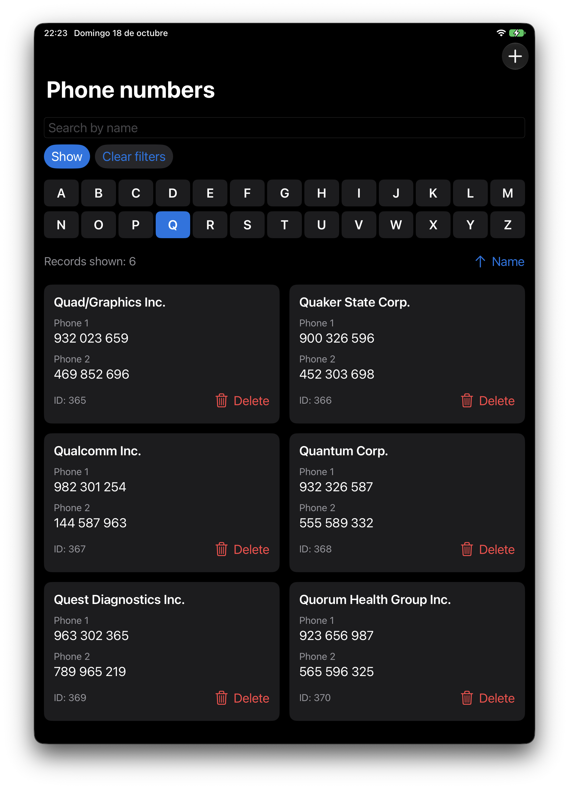

# AgendaT - Simple Phonebook Application for iPad and iPhone


AgendaT is a lightweight phonebook application built with SwiftUI for iPhone and iPad running iOS/iPadOS 16 or later. It provides a simple way to browse, search and edit phone contacts stored in an XML file.

More than an app for real use (although it works well), it should be seen as an exercise to learn SwiftUI and how to handle XML files as a data source for a dataset.

The mobile interface uses contact cards that adapt from one column on iPhone to multiple columns on iPad, including Split View. Contact forms scroll to accommodate the keyboard and larger text sizes.

|                                   |
| :-------------------------------- |
|  |

## Features

- **XML Data Source**: Phone book entries are stored in an XML file with four sub-elements:
  - Name
  - Phone 1 (numeric only)
  - Phone 2 (numeric only)
  - ID (unique numeric key, non-null)

- **Sorting**: Use the sort menu beside the record counter to sort by name, either phone number, or ID
  - Select the current sort field again to toggle ascending and descending order
  - Visual indicators show current sort field and direction

- **Adaptive Display**: Scrollable contact cards with the title "Phone numbers"

- **Search Functionality**:
  - Text search by name (partial match supported)
  - Search is applied when "Show" button is pressed
  - 26 alphabet buttons in two rows of 13 for filtering by first letter, without horizontal scrolling
  - "Clear filters" button to reset all filters and display all records

- **Edit Capabilities**:
  - Add new contacts with auto-generated IDs
  - Edit existing contacts by tapping their card
  - Delete contacts with trash icon (confirmation required)
  - Changes persist to XML file in documents directory
  - Failed saves leave edits available to retry; failed deletions leave the contact intact

- **Record Counter**: Displays the number of currently visible records
- **Localization**: English, Spanish, French, and German
- **Local Contacts**: The existing bundled phonebook and XML format are retained. This app manages its own contacts; it does not access or sync Apple's Contacts database.

## Documents directory storage

Contacts are saved as `Phonebook.xml` in the app's Documents directory. On first launch, the bundled phonebook is copied there; subsequent launches load the saved file instead.

Use **Files → On My iPhone/iPad → AgendaT**, or Finder file sharing on a connected Mac, to back up or replace this file. Fully close AgendaT before replacing it and reopen it afterward. Replacing the file replaces the entire phonebook, so keep a backup first.

To migrate existing contacts from the , copy `~/Library/Containers/perez987.AgendaT/Data/Documents/Phonebook.xml` from your Mac into AgendaT's Documents folder on the device after its first launch. The XML format is unchanged; no conversion is required.

## Project Structure

```
AgendaT/
├── AgendaTApp.swift              # Main application entry point
├── Assets.xcassets/              # App icons and visual assets
│   ├── AccentColor.colorset/
│   └── AppIcon.appiconset/
├── Info.plist
├── Model/
│   ├── FilterSortManager.swift   # Filtering and sorting logic
│   ├── LocalizationManager.swift # Language detection and localization
│   ├── PhoneEntry.swift          # Data model for phone entries
│   ├── PhonebookManager.swift    # Phonebook data management
│   └── XMLParser.swift           # XML parsing functionality
├── Resources/
│   └── Phonebook.xml             # Existing bundled phonebook
├── Languages/
│   ├── en.lproj/                 # English localization
│   ├── es.lproj/                 # Spanish localization
│   ├── fr.lproj/                 # French localization
│   └── de.lproj/                 # German localization
└── Views/
    └── ContentView.swift         # Mobile browsing and contact editor
```

## Requirements

- iPhone or iPad running iOS/iPadOS 16.0 or later
- A Mac with Xcode to build and run the app
- Xcode 15.0 or later
- Swift 5.0 or later

## Building

Open `Xcode-project/AgendaT.xcodeproj` in Xcode, select the **AgendaT** scheme, and choose an iPhone or iPad simulator. For a physical device, select your development team in Signing & Capabilities and choose the connected device.

From the repository root on a Mac, a simulator build without signing can also be run with:

```sh
xcodebuild -project Xcode-project/AgendaT.xcodeproj -scheme AgendaT \
  -destination 'generic/platform=iOS Simulator' CODE_SIGNING_ALLOWED=NO build
```

Before shipping, check portrait and landscape on a small iPhone and an iPad, iPad Split View, large Dynamic Type sizes, all sort fields and filters, add/edit/delete (including validation and cancellation), and persistence after relaunch. Confirm that a copied macOS phonebook loads correctly. There is currently no automated test target; simulator/device validation requires macOS and Xcode.
